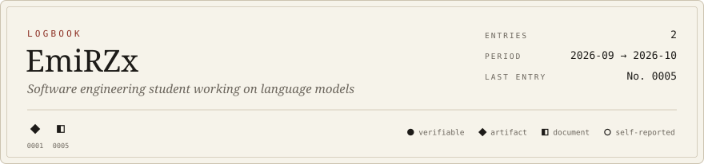

# Logbook

A numbered record of what I have built, won, studied and been certified in, with the evidence for
each entry. My CVs are compiled from it and never written by hand, so any line on them can be
traced back to an entry here and checked.

**Read it as a page:** [emirzx.github.io/logbook](https://emirzx.github.io/logbook/) ·
[Türkçe](https://emirzx.github.io/logbook/tr/)

<!-- logbook:begin -->
<picture>
  <source media="(prefers-color-scheme: dark)" srcset="assets/header-dark.svg">
  
</picture>

**Carried forward:** 2 entries · ● 0 verifiable · ◆ 1 artifact · ◧ 1 document · ○ 0 self-reported. 5 drafts await sign-off and are not shown.

## 2026

| No. | When | Entry | Evidence |
|---|---|---|---|
| `0005` | 2026-10-26 | **[Gold, Track 01: Foundational LLM Development](entries/2026/0005-gibc-v2-gold.toml)** · Global Innovation Build Challenge V2<br><sub>award · Gold award for Kestrel-49M. One Gold is awarded per track; GIBC V2 received 342 submissions across three tracks.</sub> | ◧ Winners announcement from the organizers, held privately <sub>`sha256 b1f694f7ef52…`</sub> |
| `0001` | 2026-08-31 → 2026-09-29 | **[Kestrel-49M](entries/2026/0001-kestrel-49m.toml)** · Global Innovation Build Challenge V2, Track 01<br><sub>project · A 49.5M-parameter language model trained from random initialization on a 6B-token corpus I built, with its own tokenizer, in 2.08 H100-hours.</sub> | ◆ [Repository as submitted](https://github.com/EmiRZx/kestrel-49m/tree/gibc-v2-submission)<br>◆ [Released weights, re-scored to the reported numbers](https://github.com/EmiRZx/kestrel-49m/releases/tag/v1.0.0) |

## Skills, by evidence

No self-ratings. A skill is listed only once an approved entry shows it in use.

| Skill | Area | Entries |
|---|---|---|
| Python | Languages | [`0001`](entries/2026/0001-kestrel-49m.toml) |
| LLM pretraining | Machine learning | [`0001`](entries/2026/0001-kestrel-49m.toml) |
| Model evaluation and statistics | Machine learning | [`0001`](entries/2026/0001-kestrel-49m.toml) |
| PyTorch | Machine learning | [`0001`](entries/2026/0001-kestrel-49m.toml) |
| GPU performance | Systems | [`0001`](entries/2026/0001-kestrel-49m.toml) |
| Data pipelines | Data | [`0001`](entries/2026/0001-kestrel-49m.toml) |
| Cloud GPU (Modal) | Tools | [`0001`](entries/2026/0001-kestrel-49m.toml) |
<!-- logbook:end -->

## Reading this logbook

Every entry is a TOML file under [`entries/`](entries), numbered in the order it was logged.
Nothing is deleted: a correction is a new entry that supersedes the old one, and git keeps the rest.
An entry is only as strong as its best evidence:

| Mark | Evidence | How to check it |
|---|---|---|
| ● | verifiable | A third party confirms it at the linked page: a certificate verification URL, an official results page. |
| ◆ | artifact | The work itself is linked: a repository, a release, a live demo. Judge it directly. |
| ◧ | document | A certificate or letter I hold privately. Ask me for it, then compare its SHA-256 with the one in the entry. |
| ○ | self-reported | My word only, and marked as such. |

Drafts are entries an agent or I have started but I have not signed off. They stay out of this page
and out of every CV until I do.

## How it is kept

`tools/logbook.py` checks every entry (dates, evidence, hashes, skill names, both languages) and
compiles this page, the header image, the [site](https://emirzx.github.io/logbook/) in `docs/`, and
the CVs. It uses only the Python standard library.

```bash
python tools/logbook.py check          # what CI runs on every push
python tools/logbook.py build --pdf    # this page and the site, plus English and Turkish CV PDFs in out/
python tools/logbook.py build --pack   # the same, plus a folder per CV with the documents behind it
python tools/logbook.py new certificate aws-cloud-practitioner --date 2027-01
```

The PDFs carry my name and contact details from `private/profile.toml`, which never leaves my
machine. The public pages show only what is in this repository.

Rules for people and coding agents alike are in [AGENTS.md](AGENTS.md).
